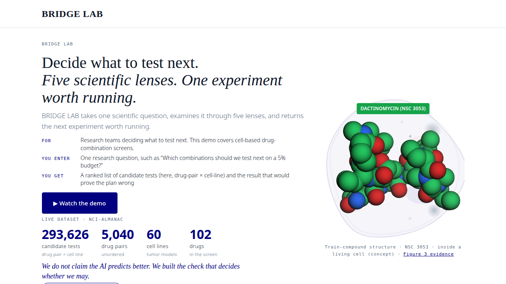
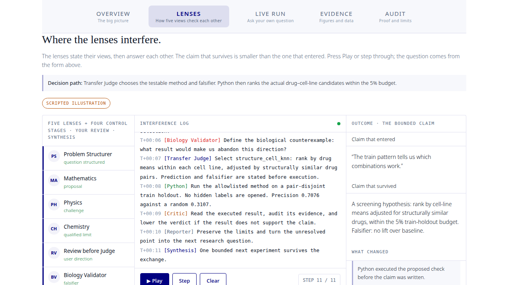

# BRIDGE LAB

**Decide what to test next.** Five scientific lenses. One experiment worth running.

BRIDGE LAB takes one scientific question, examines it through five lenses (mathematics, physics, chemistry, biology, software), and returns the next experiment worth running, ranked, with the result that would prove the plan wrong. This demo covers cell-based drug-combination screening on the public NCI-ALMANAC dataset.



*The demo homepage: one question, five lenses, one experiment worth running.*



*The Lenses tab: a scripted illustration of the five lenses challenging each other before the Transfer Judge decides.*

**Demo video:** [Watch the demo on YouTube](https://youtu.be/lPg-_okE1gE). The homepage's "Watch the demo" button opens the same link.

Built during the Meta Global AI Developer Hackathon (Indie Developer track).

## What it does

1. You ask a research question (for example: which drug combinations should we validate next with 5% of the screening budget?).
2. Eight roles run on `muse-spark-1.3` through the Meta Model API: Problem Structurer, Mathematics, Physics, Chemistry, Biology Validator, Transfer Judge, Critic, Reporter. Two further stages are not model calls: Python execution, which runs the plan and computes every number (the model never produces a score), and a human review step where the researcher can steer.
3. The Transfer Judge picks one ranking method from a fixed allowlist. Python ranks every drug-pair x cell-line candidate on training data only and shows the top candidates.
4. The Critic and Reporter judge the executed result. A verdict ceiling set by code stops them from claiming more than the evidence supports. A live run reads no held-out data, so its verdict stays "needs more evidence" by design.

Ranking methods: `exact_pair_mean`, `drug_mean`, `pair_frequency`, `drug_cell_mean` (uses the cell line) and `structure_cell_knn` (adds molecular-fingerprint similarity via RDKit).

## What we measured, and what we do not claim

- **Sealed comparison E0003.** The pipeline's selections were scored once on real hidden outcomes: precision 0.6070 / 0.5769 / 0.5034 at the 5% / 10% / 20% budgets. The single-call baseline had to return thousands of item ids in one reply and produced no valid selection in any run, so there was nothing to compare and no comparison result is reported. The full table and hashes are in the Audit tab.
- **Method development (train data only, pair-disjoint holdout, 3 seeds, precision at 5% / 10% / 20%).** `drug_mean` 0.57 / 0.54 / 0.49, `drug_cell_mean` 0.66 / 0.61 / 0.54, `structure_cell_knn` 0.72 / 0.66 / 0.57. These are development numbers, not hidden-data results.
- **E0004 is a draft.** It is preregistered in `comparison-prereg-v5/` (a baseline that only picks a method, the same Python ranking for both arms, the E0003 pair split). It is not sealed and has not been run, and it may end in a tie if both arms pick the same method.
- No patient, treatment or dosing advice. Cell-based screening only. Structure results are labeled separately and are not docking or binding evidence.

## Hackathon fit (Meta Global AI Developer Hackathon, Indie track)

- **Theme:** Push the Frontier. Accelerating a scientific experiment: choosing which drug-pair x cell-line tests to run next.
- **Meta Model API:** every live run calls `muse-spark-1.3`. Hash-chained run ledgers with `live-muse` provenance are in [`evidence/`](evidence/README.md).
- **Built during the event (Oct 27 to Nov 4):**
  - Oct 27: build started; NCI-ALMANAC downloaded from the official NCI page (zip sha256 `69367a8b654908ebf70a752548c8d240fda2b751336eff0241a5986628696100`); synthetic end-to-end verification of the comparison pipeline.
  - Before Oct 29: the train and hidden-candidate tables were built from that download.
  - Oct 29: seal E0003 created and the sealed comparison executed (see the Audit tab).
  - Nov 1 to Nov 4: ranking methods `drug_cell_mean` and `structure_cell_knn`, harness v2, the E0004 preregistration draft, the RDKit structure comparison, and the demo page.
- **Third-party material:** listed in [THIRD_PARTY_NOTICES.md](THIRD_PARTY_NOTICES.md).

## Run it

Requirements: Python 3.9+ (3.11+ recommended), a Meta Model API key.

```bash
pip3 install -r requirements.txt
cp .env.example .env      # put your own key after MODEL_API_KEY=
bash start.sh             # opens http://localhost:8791
```

The key is read from `.env` or typed at the prompt. Never commit or share `.env`.

Without a key you can still open `demo-ui/index.html`: the scripted Overview and Lenses tabs, the Evidence figures and the Audit record all work offline. The Live Run tab needs the local server and a key (a run takes about 2 to 8 minutes).

Tests (offline, no API calls): `python3 server/test_e0004.py` (21 tests, including a replay of a real recorded run through the v2 pipeline).

## Layout

| Path | What |
|---|---|
| `demo-ui/index.html` | The single-page demo (Overview, Lenses, Live Run, Evidence, Audit) |
| `server/` | Local server, live run and computational-test runners, tests |
| `bridgelab/` | Pipeline, ledger, seal, verdict ceiling, comparison scorer, decision compilers (`decision_compiler_v2.py`), harness v2 |
| `prompts/` | Role prompts |
| `comparison-prereg-v4/` | Sealed comparison E0003: preregistration, packet, pair split, train table, hidden candidate list |
| `comparison-prereg-v5/` | E0004 preregistration draft |
| `evidence/` | Recorded live-run ledgers and the E0003 sealed-run output |
| `scripts/` | RDKit structure comparison, packet hashing, model smoke test |

## Data and credits

**Data provenance.** All screening data comes from NCI-ALMANAC (Holbeck et al., *Cancer Research* 2017;77(13):3564–3576, DOI 10.1158/0008-5472.CAN-17-0489), downloaded from the official NCI Wiki on 2026-10-27 as `ComboDrugGrowth_Nov2017.zip` (SHA-256 `69367a8b654908ebf70a752548c8d240fda2b751336eff0241a5986628696100`). The raw archive itself is not redistributed here. The full download audit is in `provenance/DATA.md`. The derived tables in this repository were produced from that download as follows:

- `comparison-prereg-v4/train_items.csv` — built inside this project by `scripts/freeze_comparison_packet.py` (drug pairs split unordered, seed 42, 80/20): the 248,956 train items with their observed scores.
- `comparison-prereg-v4/hidden_candidates.csv` — the 62,510 candidate items on the 1,049 held-out pairs, built by the same script. Item ids and dose grid only; it contains no observed scores. This is the candidate list scored once in the sealed comparison E0003.
- `comparison-prereg-v4/inputs/candidate_items.csv` — an item index built from the same NCI-ALMANAC download (item ids only, no scores), prepared as an input for the E0004 draft. It was not used in E0003. Coverage against the sealed pair split: 234,040 items on train pairs and 59,586 items on hidden pairs — 28 of the 1,049 hidden pairs (2,924 items) are absent from this file, so it does not cover the full hidden candidate pool. See `comparison-prereg-v4/inputs/README.txt`.

Structures retrieved from the NCI/CADD Chemical Identifier Resolver and PubChem. RDKit for fingerprints. 3Dmol.js for the 3D viewer. Models via the Meta Model API.

## Known limits

- Needs an API key and a local server for live runs. A recorded demo video is linked from the page.
- The model chooses among a small allowlist of methods. The best-performing method was designed by us, and whether the model's choice adds predictive value is exactly what E0004 is designed to test.
- One dataset, one cell-line panel.
